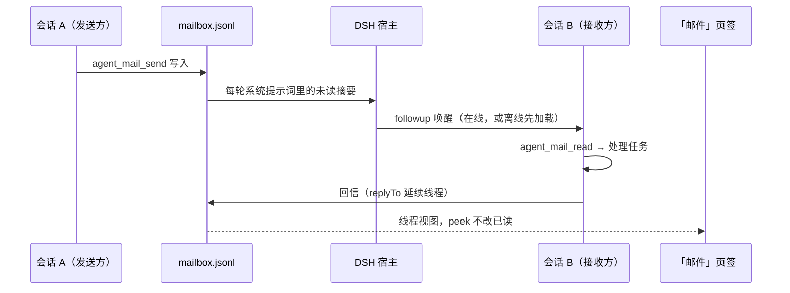

# dsh-agent-mail — DSH 会话之间的 agent 邮件

让不同会话的 agent 互发消息：**邮件不进聊天历史**，收件方在系统提示词里看到未读摘要，用户在会话上方的「邮件」页签看全部往来。

## 怎么工作

1. **写入邮箱**：`agent_mail_send` 追加到 `<dataDir>/mailbox.jsonl`（默认 `~/.dsh/agent-mail`）。
2. **提示词摘要**：每个会话有一个 `agent-mail` 系统提示词分节，只列未读邮件的 id / 发件人 / 主题，读完为空。这条路径不写会话事件日志，所以聊天历史里没有邮件内容。
3. **唤醒**（默认开）：收件方在线、或离线但允许加载时，宿主用 `agent.followup` 让它开一轮。唤醒在聊天里是一行默认折叠的「收到任务消息」，点开才看到通知原文，不是用户气泡。
4. **页签**：客户端在 `conversation.view` 注册「邮件」页，经 `/api` 的 `agentMail` 命名空间读同一个邮箱。按线程分卡，标出「→ 发出 / ← 收到」、回复的是哪封、以及「已发出 / agent 已读 / agent 未读」。对象名用**会话标题**（侧边栏可改名的那个），取不到才退化成工作区目录名、会话 id。
5. **已读只由 agent 决定**：页签展开正文不会标已读，只有 `agent_mail_read` / `agent_mail_ack` 才算；没有「全部已读」按钮。



邮件内容只走「邮箱 → 提示词摘要 → 唤醒」这条路，不写会话事件日志，所以用户聊天历史里看不到邮件。

## 工具

| 工具 | 作用 |
| --- | --- |
| `agent_mail_send` | 发信；`replyTo` 延续线程；`wake` 覆盖本次是否唤醒 |
| `agent_mail_list` | 列收件箱 / 已发件（默认 20，最多 200） |
| `agent_mail_read` | 读正文并标已读（只能读发给本会话的） |
| `agent_mail_ack` | 批量标已读，不打印正文 |
| `agent_mail_peers` | 可投递的会话：在线在前，带 `lastActivityAt` |
| `agent_mail_wait` | 同轮等一封新邮件，事件驱动，默认 60s、上限 280s；不改已读 |

## 等回信

- **首选：发完就结束本轮。** 对方回信会唤醒你开新一轮，零等待、不占工具调用。
- 必须同轮拿到答复时用 `agent_mail_wait`：对方一发信立刻返回（不是轮询），开始等之前会先看已有未读，所以「回信已落盘才调 wait」也不会白等。
- **顺序**：用户主任务优先，邮件排在当前步骤之后；例外是这一步正被这封回信阻塞，那就直接处理。判据是「是否被阻塞」，不是「谁优先」。
- 纯邮件轮只回一行摘要，不贴回执、不复述正文；只有当这封邮件是当前任务的一部分时才展开说明。

## 设置

两个入口改同一份设置：① 侧栏 **插件** → **已安装插件** → `dsh-agent-mail` → 点行标题 `agent-mail`（标题变可点、右侧出现 `›`）；② 「邮件」页签右上角 **设置**。改完立即生效、不用重启，存在 `<dataDir>/settings.json`，优先于 profile 配置；单项「用配置值」或「全部恢复配置值」可清除覆盖。

| 配置项 | 默认 | 含义 |
| --- | --- | --- |
| `wakeOnSend` | `true` | 发信后是否唤醒收件方；单次可用 `wake:false` |
| `wakeOffline` | `true` | 收件方没打开时先加载会话再唤醒；关掉则只投递 |
| `ratePerMinute` | `6` | 同一对会话每分钟最多几封 |
| `ratePerSessionMinute` | `20` | 单个会话每分钟最多收几封 |
| `maxDepth` | `5` | 回复链最深几层，超过要求 agent 先问用户 |
| `maxMailbox` | `500` | 每会话保留几封，先丢最老的已读 |
| `bodyLimit` | `8000` | 单封正文最大字符数 |
| `promptPreview` | `5` | 提示词摘要里最多列几封未读 |
| `dataDir` | `<DSH home>/agent-mail` | 邮箱目录 |

也可以直接写 profile 的 `cordis.patch.yml`（改完需重启）：

```yaml
- id: agent-mail
  config:
    wakeOnSend: false
    ratePerMinute: 10
```

## 边界

- **代价**：唤醒意味着对方自己开一轮、读信、可能回信，全程无人工确认，会消耗 token。
- **防互刷**：`maxDepth` + 每分钟限流兜底；要彻底静默就把 `wakeOnSend` 关掉，需要时单次 `wake:true`。没有每小时唤醒上限。
- **离线**：未打开的会话会被 `sessionController.resolveAgent` 加载后唤醒（返回 `resumed: true`）；已归档会话仍需先恢复。对方在跑长任务时，唤醒排在当前轮之后。
- **来源信封**：`read` / `wait` 的正文包在 `【agent 邮件 · 来自 名称(会话id) · 时间 · id=…】` 里。历史被压缩后结构化来源会丢，提示词要求压缩时保留来源与 id；邮箱原件 `mailbox.jsonl` 永久保留，随时可重读。

## 兼容性

在 **DSH 0.2.2-rc.3 + desktop profile（Windows）** 上验证。依赖的是 DSH 内部接口：宿主侧的 `ctx.tools` / `ctx.systemPrompt` / `sessionController` / `sessionQuery`，客户端槽位 `conversation.view`、`plugins.row.config`，以及 `TypertRemoteService` 的 `@Remote`。DSH 升级可能改动它们，插件不一定自动跟随；升级 DSH 后先跑一遍单测与 smoke，再实际收发一封邮件确认。

## 安装

```
dsh plugin --profile desktop add "file:<你的目录>/dsh-agent-mail"
```

装完**重启 DSH**（关掉再打开）：宿主插件、页签、配置入口都在进程启动时装配，只刷新页面不保证换到新 bundle。

**本地改代码必须 remove + add**：`file:` 依赖是拷贝进 profile 的，直接 `add` 是 no-op。

```
dsh plugin --profile desktop remove dsh-agent-mail
dsh plugin --profile desktop add "file:<你的目录>/dsh-agent-mail"
```

确认拷贝已换新：对比本目录与 `~/.dsh/profiles/desktop/node_modules/dsh-agent-mail/lib/client.js` 的 `md5sum`。

**安装别人的仓库**：克隆后把克隆目录加进 profile 即可（不要把仓库放进 DSH 安装目录，升级会删除）：

```
git clone https://github.com/yoyume374/dsh-agent-mail.git
dsh plugin --profile desktop add "file:<克隆目录>/dsh-agent-mail"
```

页签若显示「当前视图没有会话身份」，说明 `conversation.view` 的 `inject(sessionId)` 没拿到会话 id：先确认拷贝是最新，再刷新页面。

## 测试

```
node --test test/store.test.mjs test/schema.test.mjs test/service.test.mjs test/settings.test.mjs
```

覆盖邮箱读写与裁剪、回复链深度、限流、设置覆盖层、schema 方言、RPC 服务层。沙箱 smoke 需要 DSH 的宿主桩，不在本仓库内（开发环境的工作区根 `.smoke/plugin`）：`cp dsh-agent-mail/lib/*.js .smoke/plugin/lib/ && cd .smoke/plugin && node smoke.mjs`，另覆盖唤醒通知形状、离线唤醒、`wakeOffline` 开关与会话标题。

## 许可证

MIT，见 [LICENSE](LICENSE)。
